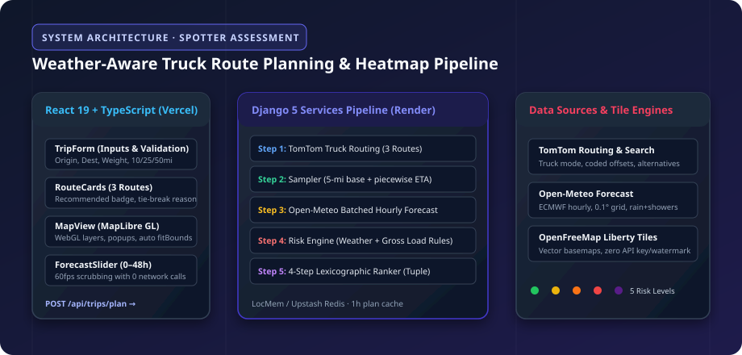

# Weather-Aware Truck Routing — Spotter Assessment

> **A React + Django web app that returns 3 truck routes, scores each for weather risk at the truck's arrival time at every checkpoint, and recommends the safest one.**



---

## 🌐 Live Demo

- **Frontend (Vercel):** `https://your-app-name.vercel.app` *(Set after Vercel deployment)*
- **Backend API (Render):** `https://truck-weather-routing-api.onrender.com` *(Set after Render deployment)*

> **Note on Render Free Tier:** Render web services on the free tier spin down when inactive. The very first request after inactivity may take 50–60 seconds to wake up. Subsequent requests respond under 1 second.

---

## 🚀 Local Setup in Under 5 Commands

### Backend (Django 5 + DRF)
```bash
cd backend
python -m venv venv && source venv/bin/activate  # On Windows: .\venv\Scripts\activate
pip install -r requirements.txt
python manage.py runserver 8000
```
*API is live at `http://127.0.0.1:8000/api/`.*

### Frontend (React 19 + TypeScript + Vite + MapLibre GL)
```bash
cd frontend
npm install
npm run dev
```
*App is live at `http://localhost:5173/`.*

---

## 🧪 Automated Tests & Verified Code Coverage

Tests are executed with `pytest` and `pytest-cov`, covering every boundary threshold, truck load escalation rule, 4-step lexicographic tie-breaker, piecewise ETA interpolation, and API contract with mocked HTTP calls (`respx`).

```bash
cd backend
pytest --cov=routing
```

### Real Test & Coverage Report (21/21 Tests Passed · 91% Total Coverage)

```
Name                             Stmts   Miss  Cover
----------------------------------------------------
routing\apps.py                      3      0   100%
routing\clients\openmeteo.py       116     12    90%
routing\clients\tomtom.py          144     31    78%
routing\serializers.py              23      2    91%
routing\services\corridor.py        44      3    93%
routing\services\planner.py         49      0   100%
routing\services\ranker.py          54      1    98%
routing\services\risk.py            52      2    96%
routing\services\sampler.py        106     12    89%
routing\tests\test_api.py           91      1    99%
routing\tests\test_ranker.py        41      0   100%
routing\tests\test_risk.py          49      0   100%
routing\tests\test_sampler.py       32      0   100%
routing\views.py                    61     14    77%
----------------------------------------------------
TOTAL                              870     79    91%
======================= 21 passed, 6 warnings in 12.90s =======================
```

---

## ⚙️ Environment Variables

### Backend (`backend/.env` / Render Environment)

| Variable | Required | Default / Fallback | Description |
| --- | --- | --- | --- |
| `DJANGO_SECRET_KEY` | Production | Development secret | Cryptographic secret for Django |
| `DEBUG` | Optional | `False` | Debug mode (must be `False` in production) |
| `ALLOWED_HOSTS` | Optional | `*` | Comma-separated allowed hostnames (e.g. `your-app.onrender.com,localhost`) |
| `CORS_ALLOWED_ORIGINS`| Optional | All origins permitted | Comma-separated frontend origins (e.g. `https://your-app.vercel.app`) |
| `TOMTOM_API_KEY` | Yes (or `DEMO_MODE=true`)| None | API key for TomTom Calculate Route and Search API |
| `REDIS_URL` | Optional | `LocMemCache` | Redis connection URL (e.g. Upstash Redis). Falls back to in-memory cache |
| `DEMO_MODE` | Optional | `false` | When `true`, enables synthetic fallback routing if `TOMTOM_API_KEY` is omitted |

### Frontend (`frontend/.env` / Vercel Environment)

| Variable | Required | Default / Value | Description |
| --- | --- | --- | --- |
| `VITE_API_BASE_URL` | Production | `""` (proxies `/api` in dev) | URL of deployed Render backend (`https://truck-weather-routing-api.onrender.com`) |
| `VITE_MAP_STYLE_URL` | Optional | OpenFreeMap Liberty style | MapLibre vector style. Needs no key and renders zero watermarks |

---

## 📐 Assumptions & Implementation Rules

1. **Inclusive Lower Bounds:** The specification ranges overlap at edges (e.g., 0.25 in/hr in both Moderate and High). Each lower bound is implemented as inclusive:
   - **Wind (mph):** Low (<25), Moderate [25, 35), High [35, 45), Severe [45, 55), No Travel (≥55)
   - **Rain (in/hr):** Low (<0.10), Moderate [0.10, 0.25), High [0.25, 0.50), Severe [0.50, 1.00], No Travel (>1.00)
   - **Snow (in/hr):** Low (<0.5), Moderate [0.5, 1.0), High [1.0, 2.0), Severe [2.0, 3.0], No Travel (>3.0)
2. **Sustained Wind for Rules, Gusts for Popups:** Sustained 10-meter wind (`wind_speed_10m`) governs risk classification and load escalation rules. Peak wind gusts (`wind_gusts_10m`) are displayed in the interactive checkpoint popup card.
3. **Rain Rate Aggregation:** Open-Meteo splits rain into large-scale `rain` and convective `showers`. Total rain rate is computed as `rain + showers` (in/hr).
4. **No Travel Miles Ranked First:** The lexicographic ranking order strictly evaluates `no_travel_mi` before `severe_mi`:
   ```python
   (no_travel_mi, severe_mi, high_mi, round(avg_risk, 2), duration_s)
   ```
   A route encountering No Travel conditions cannot win over a route with zero No Travel miles.
5. **Slider Hours Counted from Departure:** The 0–48 hour forecast slider counts elapsed hours starting from the user's selected trip departure timestamp (`+0h` to `+48h`).

---

## 🔌 API Endpoints

### 1. `POST /api/trips/plan`
Generates 3 truck routes, samples checkpoints at 5-mile base increments, evaluates ETA-specific weather risk, and returns ranked routes.

**Request:**
```json
{
  "origin": {"lat": 32.7767, "lon": -96.7970, "label": "Dallas, TX"},
  "destination": {"lat": 39.7392, "lon": -104.9903, "label": "Denver, CO"},
  "departure_at": "2026-11-08T06:00:00Z",
  "load_weight_lb": 38000
}
```

**Response (Trimmed):**
```json
{
  "trip_id": "01ea41e2caf845e1",
  "demo_mode": false,
  "recommended_route_id": "r1",
  "recommendation_reason": "14.2 fewer Severe miles than Route B",
  "no_safe_route": false,
  "routes": [
    {
      "id": "r1",
      "name": "Interstate Primary",
      "rank": 1,
      "geometry": {
        "type": "LineString",
        "coordinates": [[-96.797, 32.7767], ...]
      },
      "summary": {
        "distance_mi": 794.2,
        "duration_s": 45120,
        "arrival_at": "2026-11-08T18:32:00Z",
        "miles_by_level": {
          "Low": 610.0,
          "Moderate": 140.0,
          "High": 44.2,
          "Severe": 0.0,
          "No Travel": 0.0
        },
        "avg_risk": 0.31,
        "max_level": "High"
      },
      "checkpoints": [
        {
          "mile": 25.0,
          "lat": 33.1042,
          "lon": -97.0215,
          "intervals": [25],
          "eta": "2026-11-08T06:26:00Z",
          "weather": {
            "wind_mph": 18.2,
            "gust_mph": 27.5,
            "rain_in_hr": 0.02,
            "snow_in_hr": 0.0
          },
          "level": "Low",
          "reasons": []
        }
      ]
    }
  ]
}
```

### 2. `GET /api/trips/{trip_id}/heatmap`
Returns GeoJSON FeatureCollection with pre-computed multi-hour attributes `r0...r48` for 60fps client-side scrubbing.

### 3. `GET /api/geocode?q=dallas`
Queries TomTom Search API and returns address suggestions with coordinates.

### 4. `GET /api/health`
Health check (`{"status": "ok", "service": "truck-weather-routing"}`).
